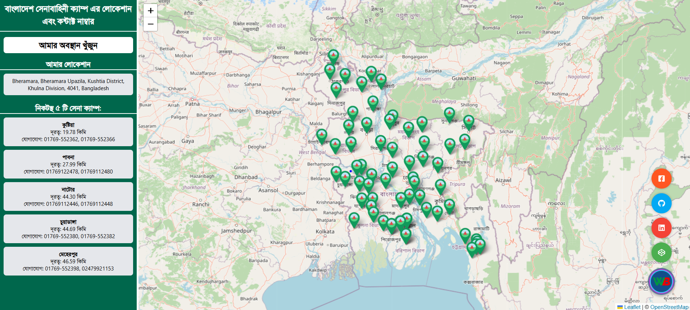

# Army Camp Location

<div align="center">
  
  
  <p>
    <strong>{project_description}</strong>
  </p>
  
  <p>
    <a href="https://github.com/wapborhan/army-camp-location/stargazers"></a>
    <a href="https://github.com/wapborhan/army-camp-location/network/members"></a>
    <a href="https://github.com/wapborhan/army-camp-location/pulls"></a>
    <a href="https://github.com/wapborhan/army-camp-location/issues"></a>
    <a href="https://github.com/wapborhan/army-camp-location/graphs/contributors"></a>
    <a href="https://github.com/wapborhan/army-camp-location/blob/main/LICENSE"></a>
  </p>
</div>

## 🌟 Overview

army-camp-location is a {detailed_project_description}. It aims to solve {problem_statement} by providing {solution_overview}.



## ✨ Features

- 🚀 **Fast Performance** - Optimized for speed and efficiency
- 🛡️ **Secure** - Built with security best practices
- 🔧 **Customizable** - Highly configurable to meet your needs
- 📱 **Responsive** - Works seamlessly across all devices
- 🌐 **Cross-platform** - Supports multiple operating systems
- 📖 **Well Documented** - Comprehensive documentation and examples

## 🎯 Quick Start

### Prerequisites

- Node.js (v14 or higher)
- yarn package manager
- Git

### Installation

1. **Clone the repository**

   ```bash
   git clone https://github.com/wapborhan/army-camp-location.git
   ```

   ```bash
    cd army-camp-location
   ```

2. **Install dependencies**

   ```bash
   yarn install
   ```

3. **Run the application**
   ```bash
   npm start
   # or
   yarn start
   ```

## 📚 Documentation

- [Installation Guide](docs/installation.md)
- [User Guide](docs/user-guide.md)
- [API Reference](docs/api.md)
- [Contributing Guidelines](CONTRIBUTING.md)
- [FAQ](docs/faq.md)

## 🏗️ Project Structure

```
army-camp-location/
├── src/
│   ├── components/
│   ├── utils/
│   └── index.js
├── docs/
├── tests/
├── examples/
├── .github/
│   ├── workflows/
│   └── ISSUE_TEMPLATE/
├── package.json
├── README.md
└── LICENSE
```

## 🤝 Contributing

We love your input! We want to make contributing to army-camp-location as easy and transparent as possible. Please see our [Contributing Guidelines](CONTRIBUTING.md) for details.

### Ways to Contribute

- 🐛 Report bugs
- 💡 Suggest new features
- 📝 Improve documentation
- 🔧 Submit pull requests

## 📊 Roadmap

- [ ] Feature 1
- [ ] Feature 2
- [ ] Feature 3
- [x] ~~Completed Feature~~

See the [open issues](https://github.com/wapborhan/army-camp-location/issues) for a full list of proposed features and known issues.

## 🏆 Contributors

Thanks goes to these wonderful people ([emoji key](https://allcontributors.org/docs/en/emoji-key)):

<!-- ALL-CONTRIBUTORS-LIST:START -->
<!-- ALL-CONTRIBUTORS-LIST:END -->

## 📄 License

This project is licensed under the MIT License - see the [LICENSE](LICENSE) file for details.

## 🙏 Acknowledgments

- Hat tip to anyone whose code was used
- Inspiration sources
- References

## 📞 Support

- 📧 Email: support@army-camp-location.com
- 💬 Discord: [Join our community](https://discord.gg/your-invite)
- 🐛 Issues: [GitHub Issues](https://github.com/wapborhan/army-camp-location/issues)

---

<div align="center">
  Made with ❤️ by <a href="https://github.com/wapborhan">@wapborhan</a>
</div>
